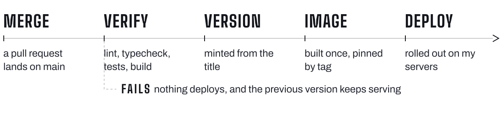

<picture>
  <source media="(prefers-color-scheme: dark)" srcset="assets/header-dark.svg">
  
</picture>

I build websites and apps and run them myself, from the servers underneath to what you see in the browser.

Everything runs on servers I set up and run myself, and CI runs on my own hardware. Every merged change is tested, versioned and deployed automatically, and if something breaks, the previous version is one step away. Frontends are always TypeScript. On the server I use TypeScript or Go, whichever suits the job.

## <picture><source media="(prefers-color-scheme: dark)" srcset="assets/h-work-dark.svg"></picture>

 **[Åsane Zoo](https://aasanezoo.com)** · Client work · since 2025 
The website of a pet store in Bergen, with booking for dog washing and carpet cleaner rental. The staff also have timesheets. The shop needs the site working during opening hours, and I’m the one who answers for it.

 **[Buvik Borettslag](https://brlbuvik.no)** · Website and board tools · since 2026 
The public site has house rules, bylaws and board news in Norwegian, English and Polish. In a separate board app, the board publishes news, lends out equipment and keeps track of contractors.

 **[Tilde](https://tilde.brandtstack.com)** · PWA · since 2026 
Counts down to and up from the days that matter. Installable, works offline and needs no account. I made it as a free alternative to a paid app.

 **Tend** · Household app · since 2026 
A household app with its own API, built for two. Chores earn points, routines send push reminders, and the shopping list updates live on both phones. It’s in use at home but not open to others, so it isn’t linked.

The amber lamp means it is in service right now.

## <picture><source media="(prefers-color-scheme: dark)" srcset="assets/h-backstage-dark.svg"></picture>

Underneath the apps and sites are a few shared services I also built myself. They sit behind a login, so they are described here rather than linked.

**Brandtstack ID** · Sign-in 
My own sign-in service, so the apps share one account. Passkeys, invite only. Written in Go.

**Internal tooling** · Private 
Per-app access control, an operations tool for the servers, CI runners on my own hardware, email authentication monitoring, link and traffic tracking, and a private analytics dashboard. Mostly Go, all behind a login.

**In the open:** [`brandtstack/workspace-ci`](https://github.com/brandtstack/workspace-ci), the reusable CI workflows and Renovate preset my repos build with.

## <picture><source media="(prefers-color-scheme: dark)" srcset="assets/h-how-dark.svg"></picture>

<picture>
  <source media="(prefers-color-scheme: dark)" srcset="assets/pipeline-dark.svg">
  
</picture>

Every repo has a `verify` command that runs lint, typecheck and tests, and CI runs it before anything ships. If it fails, nothing deploys and the previous version keeps serving. Renovate keeps dependencies current.

AI is a fixed part of how I work. Claude Code is my pair programmer through the whole cycle, from plan to finished change. I build these projects on my own, alongside a full-time job. The routine work AI takes off my hands goes into the decisions that actually need a human.

## <picture><source media="(prefers-color-scheme: dark)" srcset="assets/h-stack-dark.svg"></picture>

**Frontend** · TypeScript · React · Next.js · Vite · CSS Modules 
**Server** · TypeScript on Node.js · Go · PostgreSQL · Prisma 
**Shipping** · GitHub Actions on my own runners · container images · Renovate · Cloudflare 
**Testing** · Vitest · Testing Library · Playwright

## <picture><source media="(prefers-color-scheme: dark)" srcset="assets/h-contact-dark.svg"></picture>

Need a website or an app, or just want to talk about building and running things? Write to [kontakt@brandtstack.com](mailto:kontakt@brandtstack.com) and I’ll get back to you.

[brandtstack.com](https://brandtstack.com) · [LinkedIn](https://www.linkedin.com/in/adrian-s-brandt/)
